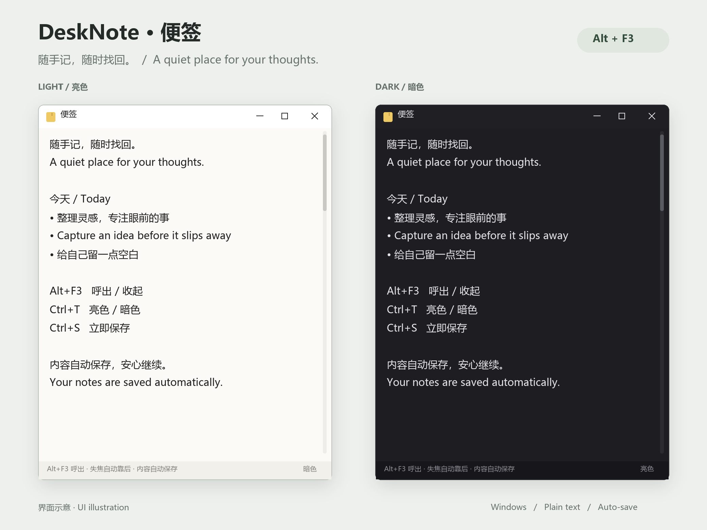

# DeskNote

[简体中文](README.md) | **English**

A quiet Windows desktop notepad. Press `Alt+F3` (customizable), capture a thought, and get back to work. Your notes save automatically.

[Download the latest release](https://github.com/suboy1219/desk-note/releases/latest) · [All releases](https://github.com/suboy1219/desk-note/releases)



*UI illustration based on the application's window layout, using public sample text; this is not a live screenshot. The app currently has a Chinese interface and accepts both Chinese and English text.*

## Features

- **Always within reach**: a global shortcut shows or hides the note, brought to the front and focused. The default is `Alt+F3`; change it via the **快捷键** button at the bottom right.
- **Stay focused**: switching to another app removes the always-on-top state and moves the note behind other windows. No taskbar button during normal use.
- **Automatic saving**: saves about 0.6 seconds after typing stops, and on focus loss or exit.
- **Light and dark themes**: use `Ctrl+T` or the bottom-right button; your preference is remembered.
- **Simple editing**: multiline plain text, tabs, no auto-wrap (long lines scroll horizontally), and a resizable window, with a minimum size of 300 × 220.
- **One tint per entry**: adjacent entries cycle through six low-saturation background tints, with a separate set for light and dark themes. Entries are separated by a little space, and text tone and size shift subtly from entry to entry. One line is one entry; an `http(s)://` link or a `- ` list item directly under a name joins that entry automatically, and a blank line always starts a new one.
- **Single instance**: launching again does not open another note.
- **Optional startup launch**: `--startup` starts hidden at sign-in, ready for the global shortcut.

## Download and run

Choose a **Windows x64** ZIP from [Releases](https://github.com/suboy1219/desk-note/releases/latest), extract it to a permanent folder, and run `DeskNote.exe`.

| File | Best for | Requirements |
| --- | --- | --- |
| `DeskNote-v1.2.0-win-x64-standalone.zip` | Recommended for most users | Includes the .NET runtime |
| `DeskNote-v1.2.0-win-x64-framework-dependent.zip` | Users who already have .NET | .NET 10 Desktop Runtime x64 |
| `SHA256SUMS.txt` | Verifying downloads | Compare SHA-256 file hashes |

Supports Windows 10 / 11 x64; no installer is needed. The standalone build extracts its bundled native libraries to a temporary directory on first launch. The smaller build requires [.NET 10 Desktop Runtime x64](https://dotnet.microsoft.com/download/dotnet/10.0).

> There is normally no taskbar button. Use your current shortcut (default `Alt+F3`) to bring the note back after hiding it. If another app has claimed the shortcut, DeskNote shows a warning and falls back to a taskbar button.

## Keyboard shortcuts

| Shortcut | Action |
| --- | --- |
| `Alt+F3` (default, customizable) | Show / hide from any app |
| `Esc` | Hide the window |
| `Ctrl+S` | Save immediately |
| `Ctrl+T` | Toggle light / dark theme |
| `Alt+F4` or the top-right `X` | Exit |

Click the **快捷键** button at the bottom right, press a new combination (it must include `Ctrl` or `Alt`; `Shift` is optional), then click **保存** to apply and remember it. **恢复默认** restores `Alt+F3`.

## Start at sign-in (optional)

DeskNote does not create a startup entry automatically.

1. Create a shortcut to the extracted `DeskNote.exe`.
2. Open the shortcut's **Properties** and append ` --startup` to its **Target**, for example: `"C:\Apps\DeskNote\DeskNote.exe" --startup`.
3. Put the shortcut in this folder (paste the path into File Explorer's address bar):

   ```text
   %APPDATA%\Microsoft\Windows\Start Menu\Programs\Startup
   ```

The app starts hidden at sign-in; press your current shortcut (default `Alt+F3`) to show it. Delete the shortcut to disable startup launch. Starting without arguments shows the window immediately. `--silent` is an alias for `--startup`.

## Data and backups

| File | Location |
| --- | --- |
| Note contents (UTF-8 plain text) | `%APPDATA%\DeskNote\note.txt` |
| Theme and shortcut preferences | `%APPDATA%\DeskNote\settings.json` |

Exit the app before copying or restoring `note.txt`. To update, replace the program files; your note is stored separately. Delete `settings.json` to restore the default light theme and the `Alt+F3` shortcut.

## Build from source

Requires Windows and the .NET 10 SDK.

```powershell
git clone https://github.com/suboy1219/desk-note.git
cd desk-note
dotnet build DeskNote.csproj -c Release
```

Standalone build, including the runtime:

```powershell
dotnet publish DeskNote.csproj -c Release -r win-x64 -p:SelfContained=true -p:PublishSingleFile=true -p:IncludeNativeLibrariesForSelfExtract=true -p:DebugType=None -p:DebugSymbols=false --artifacts-path dist/build/standalone -o dist/standalone
```

Smaller build, requiring an installed .NET 10 Desktop Runtime:

```powershell
dotnet publish DeskNote.csproj -c Release -r win-x64 -p:SelfContained=false -p:PublishSingleFile=true -p:DebugType=None -p:DebugSymbols=false --artifacts-path dist/build/framework-dependent -o dist/framework-dependent
```

Pushing a `v*.*.*` version tag triggers the [release workflow](.github/workflows/release.yml), which builds both packages, generates SHA-256 checksums, and creates a GitHub Release.

## Source layout

| File | Purpose |
| --- | --- |
| `Program.cs` | Entry point, single-instance handling, and launch arguments |
| `NoteForm.cs` | Editing, automatic saving, themes, and window behavior |
| `HotkeyDialog.cs` | Shortcut-change dialog and key validation |
| `Interop.cs` | Win32 hotkeys, window ordering, and theme APIs |
| `app.ico` | Application icon |

## Limitations

- One plain-text note; no images, rich text, multiple pages, or cloud sync.
- If another app uses the default `Alt+F3`, click the **快捷键** button at the bottom right to choose another combination.
- Documentation is available in Chinese and English; the app's buttons and messages are currently in Chinese.
