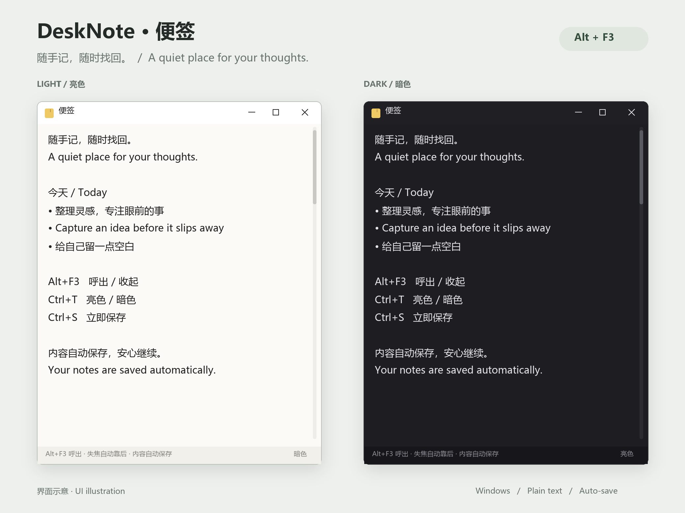

# DeskNote · 便签

**简体中文** | [English](README.en.md)

一个安静的 Windows 桌面便签。按 `Alt+F3`（可更换）随时呼出，写下灵感，切回工作；内容自动保存。

[下载最新版本](https://github.com/suboy1219/desk-note/releases/latest) · [所有版本](https://github.com/suboy1219/desk-note/releases)



*按实际窗口布局绘制的界面示意，使用公开示例文字；不是实机截图。应用界面目前为中文，支持输入中英文。*

## 功能

- **随叫随到**：全局快捷键呼出 / 收起，呼出时置顶并聚焦；默认 `Alt+F3`，可在右下角「快捷键」中更换。
- **专注工作**：点击其他软件后取消置顶、沉到底层；平时不显示任务栏按钮。
- **自动保存**：停止输入约 0.6 秒后保存，失焦或退出时也会保存。
- **亮色 / 暗色**：`Ctrl+T` 或右下角按钮切换，记住主题偏好。
- **轻巧编辑**：多行纯文本、Tab、不自动换行（超长行可横向滚动），窗口可拉伸，最小 300 × 220。
- **每条一种底色**：相邻条目用 6 种低饱和底色轮换，亮色 / 暗色各一套色调，易区分又不刺眼；条目之间留有空隙，文字深浅与字号也会随条目轻微变化。一行就是一条；名称下面紧跟的 `http(s)://` 链接或 `- ` 列表项会自动并进同一条；想强制分开，中间空一行即可。
- **单实例**：重复启动不会打开多个便签。
- **可选开机自启**：支持 `--startup` 参数，登录后先隐藏，等待快捷键呼出。

## 下载与运行

在 [Releases](https://github.com/suboy1219/desk-note/releases/latest) 选择 **Windows x64** 压缩包，解压到固定目录后双击 `DeskNote.exe`。

| 文件 | 适合谁 | 运行要求 |
| --- | --- | --- |
| `DeskNote-v1.2.0-win-x64-standalone.zip` | 推荐，大多数用户 | 已包含 .NET 运行时 |
| `DeskNote-v1.2.0-win-x64-framework-dependent.zip` | 已安装 .NET 的用户 | .NET 10 Desktop Runtime x64 |
| `SHA256SUMS.txt` | 校验下载文件 | 比对 SHA-256 哈希值 |

支持 Windows 10 / 11 x64，无需安装器。完整包首次运行时会将内嵌本机库解压到临时目录。精简包请安装 [.NET 10 Desktop Runtime x64](https://dotnet.microsoft.com/download/dotnet/10.0)。

> 平时不在任务栏显示，收起后请用当前快捷键唤回（默认 `Alt+F3`）。若快捷键被其他软件占用，应用会提示并退回任务栏显示。

## 快捷键

| 快捷键 | 操作 |
| --- | --- |
| `Alt+F3`（默认，可更换） | 全局呼出 / 收起 |
| `Esc` | 隐藏窗口 |
| `Ctrl+S` | 立即保存 |
| `Ctrl+T` | 切换亮色 / 暗色 |
| `Alt+F4` 或右上角 `X` | 退出程序 |

点击右下角「快捷键」按钮，直接按下新的组合键（需包含 `Ctrl` 或 `Alt`，`Shift` 可搭配使用），再点「保存」即可生效并自动记住；「恢复默认」可还原为 `Alt+F3`。

## 开机自启（可选）

程序不会自动修改启动项。

1. 为解压后的 `DeskNote.exe` 创建快捷方式。
2. 在快捷方式「属性 → 目标」的路径后加上 ` --startup`，例如：`"C:\Apps\DeskNote\DeskNote.exe" --startup`。
3. 将快捷方式放入以下文件夹（可粘贴到资源管理器地址栏）：

   ```text
   %APPDATA%\Microsoft\Windows\Start Menu\Programs\Startup
   ```

登录后在后台运行，按当前快捷键（默认 `Alt+F3`）呼出。删除快捷方式即可取消自启。不带参数手动启动时直接显示窗口。`--silent` 与 `--startup` 等效。

## 数据与备份

| 文件 | 位置 |
| --- | --- |
| 便签内容（UTF-8 纯文本） | `%APPDATA%\DeskNote\note.txt` |
| 主题与快捷键偏好 | `%APPDATA%\DeskNote\settings.json` |

退出程序后复制 `note.txt` 即可备份或还原。更新时替换程序文件即可，数据保存在独立目录。删除 `settings.json` 可恢复默认亮色主题与 `Alt+F3` 快捷键。

## 从源码构建

需要 Windows 和 .NET 10 SDK。

```powershell
git clone https://github.com/suboy1219/desk-note.git
cd desk-note
dotnet build DeskNote.csproj -c Release
```

完整包（包含运行时）：

```powershell
dotnet publish DeskNote.csproj -c Release -r win-x64 -p:SelfContained=true -p:PublishSingleFile=true -p:IncludeNativeLibrariesForSelfExtract=true -p:DebugType=None -p:DebugSymbols=false --artifacts-path dist/build/standalone -o dist/standalone
```

精简包（依赖已安装的 .NET 10 Desktop Runtime）：

```powershell
dotnet publish DeskNote.csproj -c Release -r win-x64 -p:SelfContained=false -p:PublishSingleFile=true -p:DebugType=None -p:DebugSymbols=false --artifacts-path dist/build/framework-dependent -o dist/framework-dependent
```

推送 `v*.*.*` 版本标签后，[发布工作流](.github/workflows/release.yml) 会构建两个包、生成 SHA-256 校验文件，并创建 GitHub Release。

## 源码结构

| 文件 | 作用 |
| --- | --- |
| `Program.cs` | 程序入口、单实例与启动参数 |
| `NoteForm.cs` | 编辑、自动保存、主题与窗口行为 |
| `HotkeyDialog.cs` | 更换全局快捷键的对话框与按键校验 |
| `Interop.cs` | Win32 热键、窗口层级与主题接口 |
| `app.ico` | 应用图标 |

## 已知限制

- 只有一个纯文本便签，不支持图片、富文本、多页或云同步。
- 默认快捷键 `Alt+F3` 若被其他软件占用，可点击右下角「快捷键」换一个组合。
- 文档提供中英文版本，应用自身的按钮与提示目前为中文。
